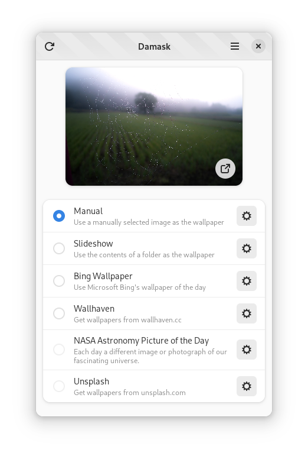

# Damask

Damask is an application that will automatically set wallpaper images by
selecting images from a variety of sources, including local files and folders.
It currently supports setting the wallpaper image from the following sources:

* wallhaven.cc
* Microsoft Bing Wallpaper of the day
* NASA Astronomy Picture of the Day



## Installation

<a href='https://flathub.org/apps/details/app.drey.Damask'></a>

```sh
flatpak install app.drey.Damask
```

## Translations

Damask is accepting translations through Weblate. If you'd like to contribute a
translation in your language, visit the [Weblate
project](https://hosted.weblate.org/engage/damask/).

<a href="https://hosted.weblate.org/engage/damask/">
  
</a>

## Development

Damask can be compiled and run with [GNOME
Builder](https://wiki.gnome.org/Apps/Builder) or locally using `meson` and `ninja`.

```sh
cd damask
meson configure builddir
meson compile -C builddir
```

### Flatpak Permissions

_Damask_ makes use of XDG portals. When running in a Flatpak, access to the
portals needs to be granted by the user. Normally, the permissions are granted
when the user installs the Flatpak. However, when running the Flatpak from a
development environment like GNOME Builder, the permissions aren't automatically
added. To make sure permissions will work when developing _Damask_, you must
grant the permissions explicitly, otherwise _Damask_ will not be able to set the
background.

```bash
flatpak permission-set wallpaper wallpaper app.drey.Damask.Devel yes
flatpak permission-set background background app.drey.Damask.Devel yes
```

### Code of Conduct

When interacting with the project, the [GNOME Code of Conduct](https://conduct.gnome.org/) applies.

### Use of Generative AI

We welcome the use of generative AI tools to assist with development. However,
**you are fully responsible for all code you submit** - review, understand,
and test everything thoroughly regardless of how it was generated.

Large patches that appear primarily AI-generated may be rejected in favor of
smaller, more thoughtful human contributions. Quality and genuine engagement
with the codebase matter more than quantity.
